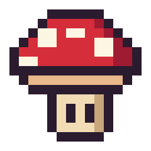
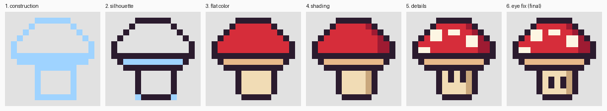

# claude-draw

A Claude Code plugin that lets Claude **draw game art by hand**. Claude makes explicit, inspected
drawing actions on a local, deterministic canvas. There is no Stable Diffusion, Flux, DALL-E, image
API, or diffusion model anywhere in it.

Version 0.1 is the **pixel-art milestone**. Illustration tools (Bezier strokes, brush width, opacity)
come next; see [Roadmap](#roadmap).



*16x16 sprite drawn step by step through the MCP tools from
[`examples/reference/mushroom_ref.png`](examples/reference/mushroom_ref.png).*



*Frames from the logged session ([`examples/sessions/mushroom16`](examples/sessions/mushroom16)). Step 6 is a
surgical correction: at sprite size, the eyes touching the band outline read as drips, so they were moved
down 1px with two pixel actions.*

## What's in the plugin

| Component | Path | Purpose |
|---|---|---|
| MCP server `canvas` | `.mcp.json`, `server/claude_draw_server.py` | Drawing, inspection, layers, undo, export, and session tools |
| Canvas engine | `server/claude_draw/canvas.py` | Deterministic RGBA layers, exact pixel ops, selection mask, undo/redo |
| Inspection renderer | `server/claude_draw/render.py` | Upscaled views with pixel grid and coordinate rulers; reference compare/overlay; exact text pixel maps |
| Trajectory log | `server/claude_draw/session.py` | Persistent, replayable JSONL, plus per-step frames and the exact views Claude saw |
| Skill `draw` | `skills/draw/SKILL.md` | The iterative drawing workflow (`/claude-draw:draw`) |

## Install

Requirements: [uv](https://docs.astral.sh/uv/). The server is a PEP 723 script, and uv fetches its two
dependencies (`mcp`, `pillow`) on first start.

From this repository (it contains a marketplace at `.claude-plugin/marketplace.json`):

```bash
claude plugin marketplace add LiquidGlek/ProjectPlanning   # or a local clone path
claude plugin install claude-draw@liquidglek-plugins
```

For development, you can load it straight from disk with `claude --plugin-dir ./claude-draw`.
Check that it is running with `claude mcp list`, which should show `plugin:claude-draw:canvas ... Connected`.

## Use

```
/claude-draw:draw knight 32x32 refs/knight.png
```

Or just ask: "draw a 16x16 potion sprite". The skill's description triggers it automatically.

The skill runs this loop:

```
reference + current canvas -> inspect -> <=10 explicit actions -> render -> inspect the result
  -> name specific errors (with coordinates) -> correct surgically -> continue
```

It moves through these stages: composition, construction, proportion review, silhouette, internal
forms, cleanup, color, shading, details, final review.

### Tools

| Tool | What it does |
|---|---|
| `new_canvas(name, width, height, background?, palette?)` | New native-resolution canvas and session |
| `load_reference(path, fit?, box?)` | Maps a reference image onto canvas coordinates and reports its dominant colors |
| `set_palette(colors)` | Named colors, usable anywhere a color is accepted |
| `draw(actions, intent, region?)` | Up to 10 actions per call: `pixel`, `line`, `rect`, `ellipse`, `fill`, `erase`, `select`, `deselect`, `move_selection`, `flip_selection`. The batch is atomic. **Every call returns a render.** |
| `inspect(view, region?, scale?, grid?, pixel_map?)` | Views: `canvas`, `reference`, `compare` (side by side), `overlay`. `region` zooms or crops. `pixel_map` returns the exact pixels as text. |
| `undo(steps)` / `redo(steps)` | Each action is one undo step |
| `layers(action, ...)` | `list`, `add`, `select`, `update` (rename/visible/opacity), `delete`, `move`, `merge_down` |
| `export_png(path?, scale?, layer?)` | PNG export, with optional nearest-neighbour upscale |
| `status`, `list_sessions`, `open_session` | Session info, and resuming a session by trajectory replay |

### Guardrails against "blind" drawing

- `draw` accepts at most 10 actions per call, and each action at most 64 points. This is enforced in
  the tool schema.
- Every mutating call returns the rendered canvas along with a per-action report (pixels changed,
  bounding box, warnings such as out-of-bounds pixels or pixels protected by the selection).
- With a reference loaded, `draw` **refuses** to go past 20 actions (`CLAUDE_DRAW_COMPARE_EVERY`)
  until Claude runs `inspect(view="compare"|"overlay")`.
- An active `select` rectangle masks painting, so finished areas can be protected during nearby edits.

## Trajectory data

Sessions are stored under `<project>/.claude-draw/sessions/<id>/` (override the location with
`CLAUDE_DRAW_HOME`):

```
trajectory.jsonl    one event per line: new_canvas, load_reference, actions, undo, redo,
                    inspect, rejected, export, resume
frames/NNNNN.png    native-resolution canvas after each mutating event
views/NNNNN.png     the exact image returned to the model at that step
references/         copies of loaded references
exports/            default export location
```

An `actions` event records the `intent`, the action list (each action with its `label`), the
per-action reports, and a `canvas_sha`. Rejected batches are logged too, including those blocked by
the compare gate. The renderer is deterministic, so `open_session` rebuilds the canvas by replaying
the log and checks it against the logged hash. The pairs of (observation view, intent + actions,
next frame) are the intended training records.

## Tests

```bash
uv run --script tests/test_engine.py   # canvas ops, selection, layers, undo, replay, renderer
uv run --script tests/test_mcp.py      # spawns the server over stdio like Claude Code; tools, gate, atomicity, resume
claude plugin validate .
```

`tests/mcp_call.py` is a small stdio client for driving the server by hand. `tests/make_reference.py`
regenerates the synthetic reference.

## Design notes

- **From SketchAgent** ([yael-vinker/SketchAgent](https://github.com/yael-vinker/SketchAgent), MIT):
  - a labelled coordinate grid on every view, so the model can name exact locations;
  - drawing in small stroke groups, each with a short descriptive label;
  - revising after visual feedback.

  No SketchAgent code is used yet. Its least-squares Bezier fitting (points + t-values) is the planned
  basis for the illustration milestone.
- **Pixel ops write exact RGBA values**, with no anti-aliasing or blending. This keeps results
  reproducible bit-for-bit, makes the text pixel map exact, and lets replay act as a determinism check.
- **Why a text pixel map:** views are upscaled PNGs, and vision can still misjudge single pixels.
  `pixel_map` gives ground truth.

## Limitations (v0.1)

- Pixel mode only: no anti-aliased strokes, Bezier curves, or brush opacity yet.
- Undo keeps whole-canvas snapshots (up to 200). That is fine for sprites; large illustration
  canvases will need a diff-based history.
- Rectangular selections only.
- One active session per server process.
- The skill's process (stages, cadence) is guidance. Only the per-call cap, the always-returned
  render, and the compare gate are enforced.

## Roadmap

1. Illustration tools: Bezier strokes (SketchAgent-style point + t fitting), brush width, opacity,
   anti-aliased raster strokes, erase strokes, soft fills.
2. Selection from color, lasso, and shape.
3. Trajectory export into a flat (observation, action, next-observation) dataset format.
